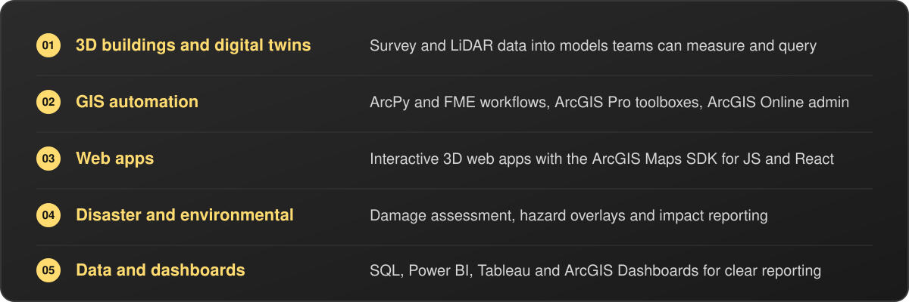
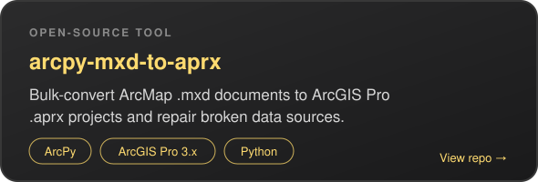
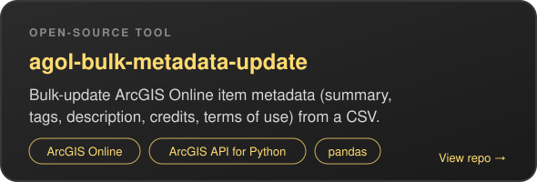
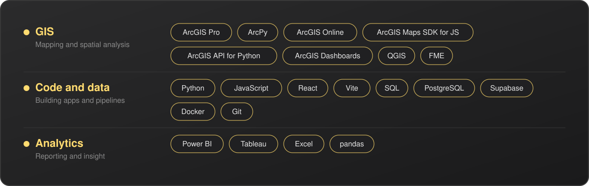

  
  

### Hi there 

I'm **Rajesh Dulal**, a **GIS developer** who turns spatial data into tools people actually use, from Python scripts that save GIS teams days of manual work to interactive **3D web apps** for planning and decision-making. My background is in GIS applications and data analytics, and I like working where the two meet.

I'm especially drawn to **public sector, environmental and urban planning** work: projects that are technically sound and make a difference on the ground.

### 🛠️ What I work on

### 📦 Open-source tools

  
  

### 💻 Tech stack

### 🔭 Currently exploring

GeoAI, machine learning and spatial data science, and using AI agents to automate GIS workflows.

### 🎞️ Off the map

Outside of GIS, I'm usually behind a camera. Photography is my favourite way to see places differently.

---

If my tools have saved you some time, consider buying me a coffee/tea ☕

